# Budget — ton tableau de bord financier, 100 % local

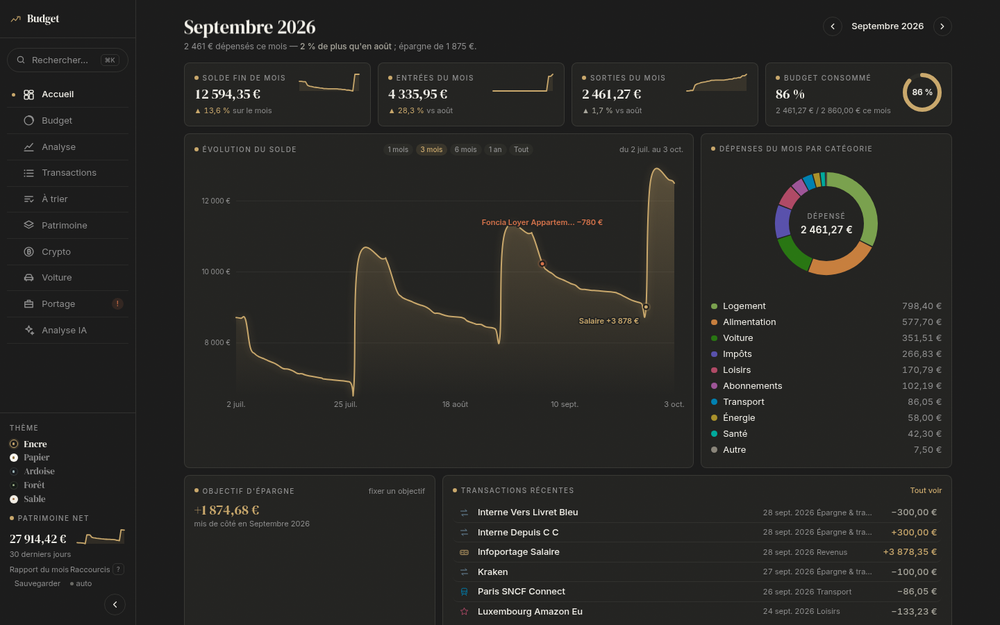

Budget, patrimoine, voiture et portage salarial réunis sur un seul écran. Tes relevés bancaires s'importent et se catégorisent tout seuls. Une analyse IA répond à tes questions et propose des modifications, que tu confirmes une par une. Tout reste sur ton ordinateur, chiffré.

**Essayer en 2 minutes, avec des données factices :**

```bash
git clone <url-du-dépôt> budget && cd budget
npm ci
npm run demo        # ouvre http://localhost:5180 avec 18 mois d'opérations inventées
```

## Ce que ça fait

| Page | En bref |
|---|---|
| **Accueil** | Solde, entrées et sorties du mois, budget consommé, évolution du solde, dépenses par catégorie, opérations récentes et prélèvements à venir. |
| **Budget** | Une enveloppe par catégorie et des objectifs d'épargne. Les périodes de vacances regroupent les dépenses du séjour. En janvier, les enveloppes suivent l'inflation en un clic, partout ou poste par poste. |
| **Analyse** | Épargne et taux d'épargne mois par mois, courbes par catégorie et sous-catégorie, classement des commerçants. Inflation année par année face à tes revenus, et **ton inflation perso** : les postes de l'INSEE pondérés par tes dépenses. Les abonnements dont le prix monte plus vite que l'inflation sont signalés, avec le surcoût par an. |
| **Transactions** | Recherche et filtres. Catégorie et sous-catégorie se changent en un clic, l'app apprend des règles et repère les virements entre tes comptes. |
| **Patrimoine** | Comptes et livrets, crypto (Kraken), épargne salariale. **Rendement réel** de chaque placement face à l'inflation, projection à 5, 10 ou 20 ans en euros d'aujourd'hui avec la date de tes objectifs, et **coût réel des crédits** : taux retrouvé dans tes relevés, intérêts restants, remboursement anticipé simulé. Tes biens (voiture, instruments…) sont suivis à part. |
| **Voiture** | Fiche illustrée avec ta plaque, valeur retenue que toi seul valides (offre de reprise, cote Argus ou La Centrale, vente… avec sa source et sa date), estimation par annonces comparables sur demande, simple proposition à valider, liens préremplis vers L'argus, AutoScout24, Leboncoin, HistoVec, coût réel par mois, courbe du compteur et prochaines échéances : contrôle technique, 100 000 km, garantie. |
| **Portage salarial** | Compte d'activité, fiches de paie, notes de frais rapprochées de tes achats par carte, titres-restaurant, chèques culture. Si le taux de prélèvement est trop bas, l'app provisionne l'impôt manquant. |
| **Analyse IA** | Tu poses une question sur tes chiffres ou demandes un rapport, et tu peux joindre une facture en PDF. Claude propose des modifications ; rien ne change sans ton « Confirmer ». |

| | |
|---|---|
| 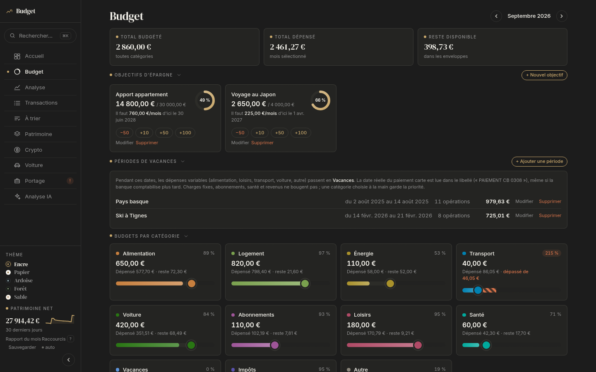 | 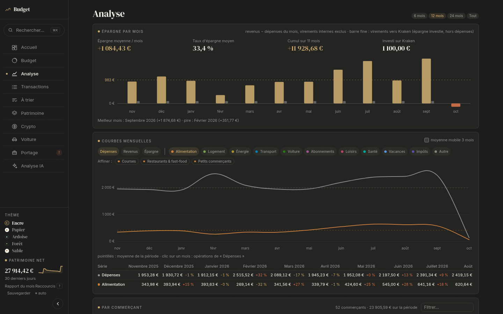 |
| 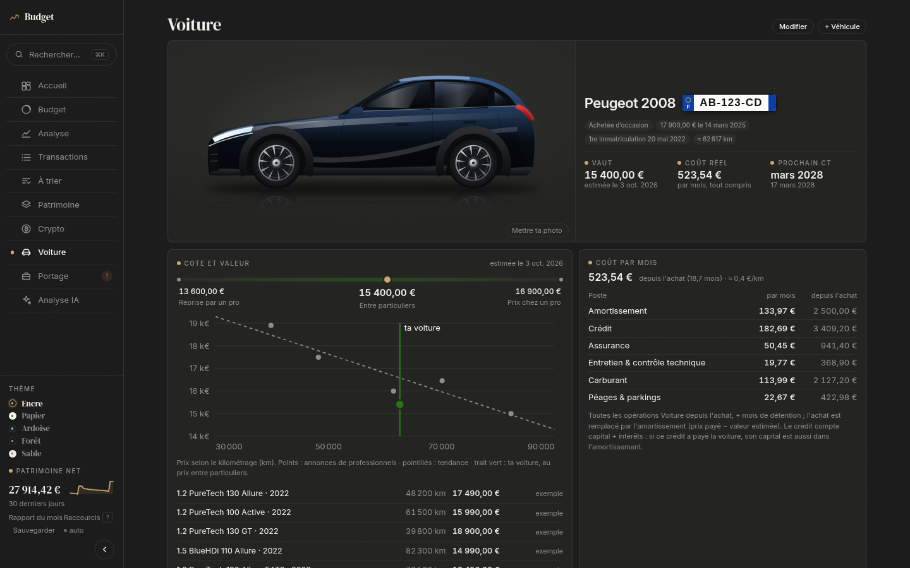 | 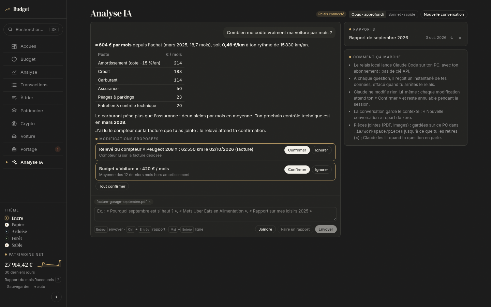 |
| 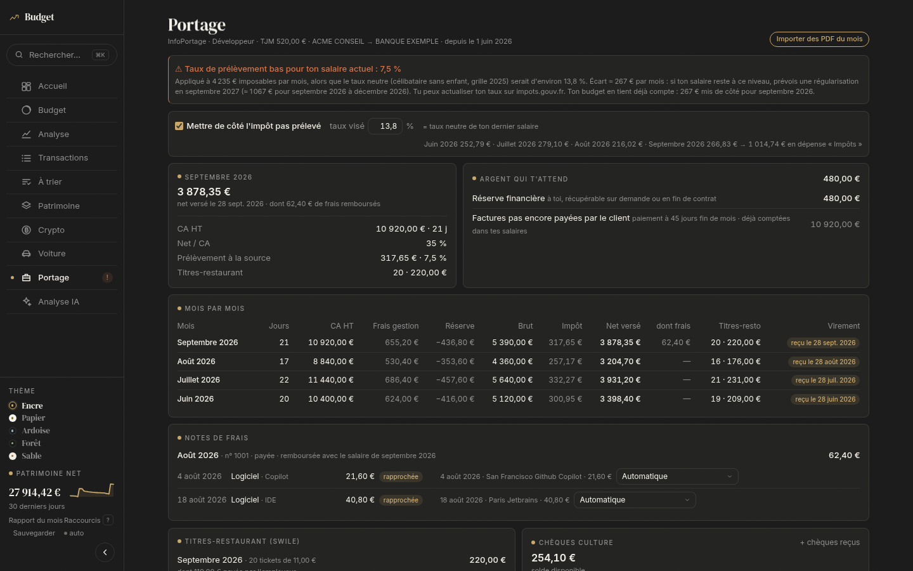 | 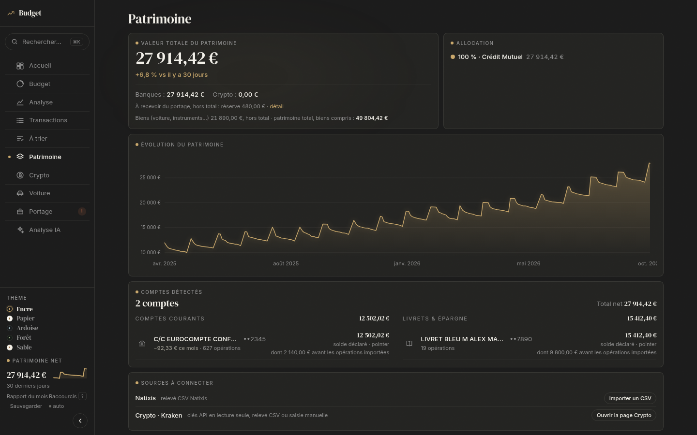 |
| 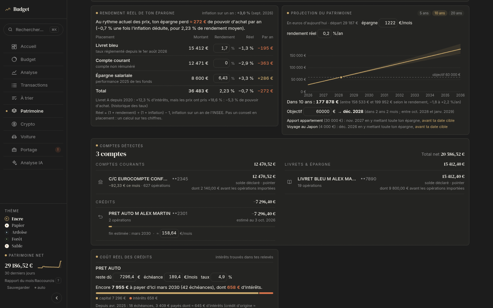 | 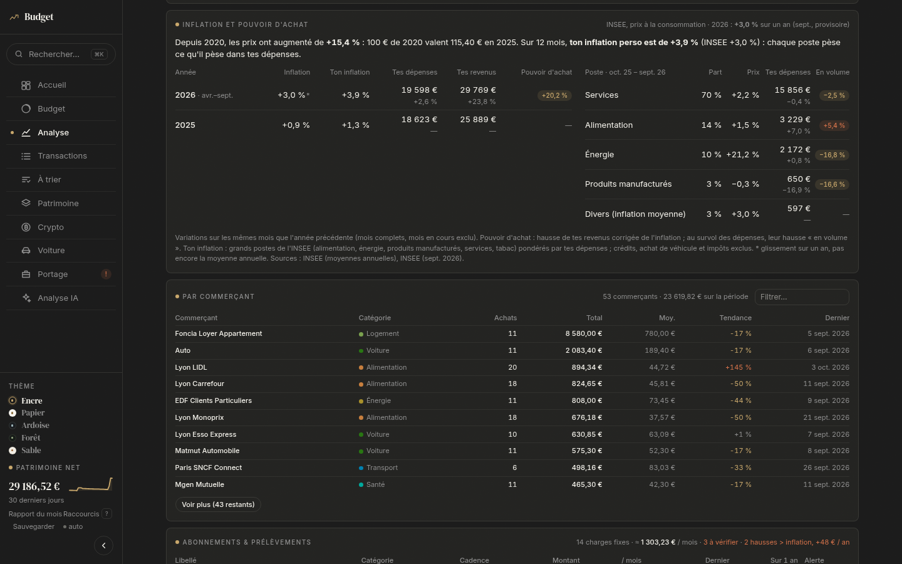 |

<p align="center">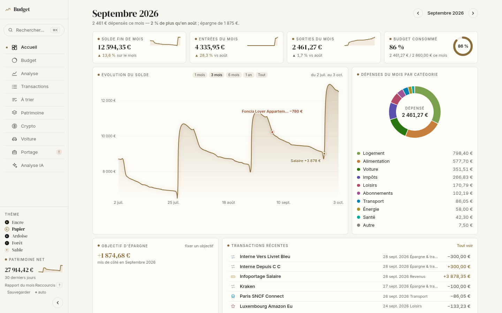 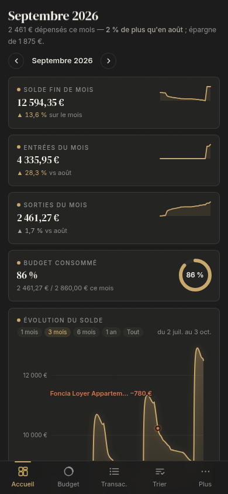</p>

L'app propose 8 thèmes (Porcelaine par défaut et sa version de nuit, Aube pour la lumière du jour, Encre, Papier, Ardoise, Forêt, Sable) et trois densités, réunis avec les sauvegardes dans les Réglages (`Ctrl+,`). Chaque page se pave en tuiles, comme un gestionnaire de fenêtres (Hyprland) : on maintient un bloc pour le déplacer, on le redimensionne au pixel au clic droit, on range les blocs qui ne servent pas et on choisit les éléments affichés à l'intérieur. Elle s'adapte au mobile et se pilote au clavier (`Ctrl+K`, `G` puis une lettre).

## Imports pris en charge

| Source | Fichier | Ce qui est lu |
|---|---|---|
| Crédit Mutuel | export CSV ou XLSX | opérations, catégories de la banque, comptes et soldes |
| Toute banque | relevé OFX/QFX, QIF ou CAMT.053/052 (ISO 20022) | opérations, compte, solde ; un mouvement déjà importé par un autre export n'est pas ajouté deux fois |
| Carte Krak | relevés PDF | paiements carte |
| Kraken | API en lecture seule, ou export CSV | soldes, historique, prix de revient, plus-values |
| Natixis Interépargne | PDF et CSV | épargne salariale, versements, performance |
| impots.gouv | avis d'impôt (PDF) | impôt, prélèvements sociaux, revenu fiscal de référence, reste à payer |
| Amazon | export des commandes | articles, qui donnent la sous-catégorie de chaque paiement |
| InfoPortage | compte d'activité, fiche de paie, note de frais (PDF) | chiffre d'affaires, salaire, frais, titres-restaurant, prélèvement à la source |

Ta banque n'est pas dans la liste ? Essaie d'abord son export OFX, QIF ou CAMT ; sinon lis « Contribuer » plus bas : un parseur suffit.

## Sécurité et vie privée

- **Base chiffrée** : SQLite avec SQLCipher, et chaque valeur chiffrée en plus en AES-256-GCM. La clé reste dans le trousseau du système (`secret-tool`), jamais dans un fichier.
- **Local seulement** : le serveur n'écoute que `localhost`. CSP stricte, requêtes de même origine uniquement, CORS fermé.
- **Kraken** : les clés API restent dans le trousseau. Le serveur signe lui-même les appels, limités à la lecture (`Balance`, `Ledgers`) ; le navigateur ne voit jamais le secret.
- **Coffre** : tes documents d'origine (PDF, exports) sont rangés chiffrés dans la base.
- **Sauvegardes** : une copie chiffrée par jour, les 14 dernières sont gardées. Le multi-onglet est protégé contre les écrasements.
- **Météo** (optionnelle) : le serveur local interroge Open-Meteo, sans compte ni clé. Deux choses sortent, rien d'autre : le nom de ville tapé dans Réglages (pour la retrouver), puis les coordonnées de la ville choisie (pour sa météo, affichée en haut de l'accueil).
- **Analyse IA** : passe par un relais local vers Claude Code (ton abonnement Claude, sans clé API), confiné dans un bac à sable sans réseau. Les données en clair sont effacées après chaque réponse.

## Installation

Il te faut Node.js 22 ou plus, et Linux avec un trousseau Secret Service (GNOME Keyring ou KWallet récent, via `secret-tool`).

```bash
npm ci
npm run dev                 # http://localhost:5173
```

Importe ensuite tes fichiers : glisse-les n'importe où dans l'app. Le panneau qui s'ouvre à droite reconnaît chaque format tout seul.

**Analyse IA (optionnel)** : installe [Claude Code](https://claude.com/claude-code) et connecte-le. Lance `npm run ia`, puis colle le jeton affiché dans la page Analyse IA. `npm run ia:install` installe le relais comme service utilisateur.

Outil de la base : `npm run base -- etat`. La commande `sql` lance une requête SQL en lecture seule, `export` affiche une clé, `coffre` liste les documents.

## Développement

```bash
npm test          # tests (node:test via tsx)
npm run check     # svelte-check + TypeScript strict
```

- **Stack** : Svelte 5 (runes), Vite, Tailwind 4, TypeScript strict, better-sqlite3-multiple-ciphers, pdf.js.
- **`src/lib/`** : la logique, en modules purs testés hors navigateur (catégorisation, imports, calculs). Les fichiers `*.svelte.ts` sont les stores réactifs.
- **`src/pages/`** : une page par onglet.
- **`server/`** : base chiffrée, trousseau, proxy Kraken signé.
- **`scripts/`** : outil de la base, données de démo, relais IA.

## Contribuer

Les contributions sont bienvenues, en particulier :

1. **Une nouvelle banque.** Écris un parseur qui produit des `Transaction` (exemples : `src/lib/csvCreditMutuel.ts`, `src/lib/xlsxCreditMutuel.ts`), ajoute sa signature dans `src/lib/importDetection.ts` (panneau Imports), branche-le dans l'import, puis ajoute un test dans `tests/` avec un petit fichier d'exemple.
2. **D'autres documents.** Autres sociétés de portage, autres épargnes salariales, autres avis.
3. **Le trousseau sous macOS et Windows** (`server/trousseau.ts`), pour que l'app tourne partout.
4. **Des mots-clés de catégorisation** (`src/lib/merchantDict.ts`, `src/lib/subDict.ts`).

Pour proposer un changement :

1. Fork, puis crée une branche.
2. Fais passer `npm test && npm run check`.
3. Ouvre une pull request, avec une capture si l'interface change.

**Jamais de vraies données** dans les tests ni dans les issues : invente les libellés, les montants et les numéros.

## Licence

[MIT](LICENSE) : tu peux utiliser, modifier et redistribuer le code, à condition de garder la mention de licence.

Les logos de marques affichés sur les opérations viennent de collections libres, via Iconify : Simple Icons, SVG Logos et CoreUI Brands (CC0), theSVG (MIT) et Arcticons (CC BY-SA 4.0, Donno et contributeurs). Les marques et leurs logos restent la propriété de leurs titulaires ; l'app ne les utilise que pour reconnaître un commerçant.
